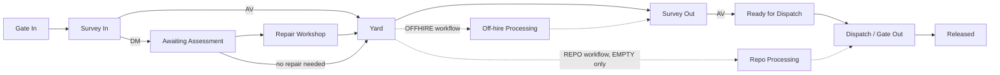
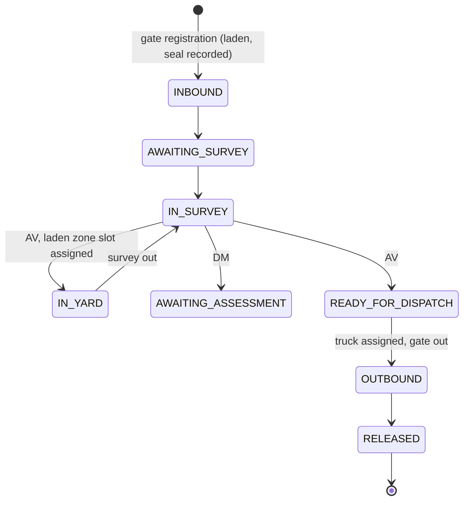
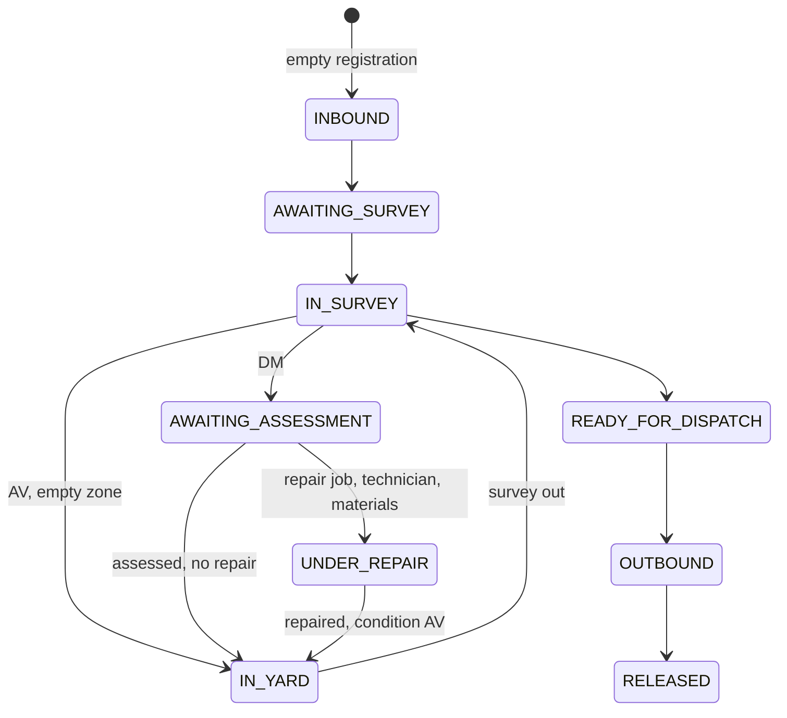

# Operational Workflows

Workflows are configuration, not one rigid lifecycle. A container follows exactly one workflow (`STANDARD`, `OFFHIRE`, `REPO`) that decides which operational statuses it may enter. Rules marked **P** are provisional and listed as Producer decisions in section 6. Nothing here invents depot rules beyond the brief; where the brief is silent, the doc says so.

## 1. Departments and how they connect

Departments: Gate, Survey, Yard, Repair Workshop, Equipment, Off-hire, Repo, Dispatch. Each department has capacity (staff, equipment, bays) and a queue. A department never blocks silently: when capacity is exceeded the queue grows and the dashboard shows it.

## 2. Status model

Cargo (`EMPTY`/`LADEN`), condition (`AV`/`DM`/`UNDER_INSPECTION`/`REPAIR_REQUIRED`) and operational status (11 values) are independent; see `docs/CONTAINER_DATA_MODEL.md`. Survey kind (in/out) is a field of the survey record, not a status (D3).

## 3. Standard workflows

### 3.1 Laden inbound, storage, outbound

A damaged laden container stops at `AWAITING_ASSESSMENT`. **P**: it cannot enter `UNDER_REPAIR` while laden (D1). Laden storage uses laden yard zones and laden tariffs.

### 3.2 Empty inbound, storage and repair

Repair duration, materials and cost depend on damage type. Quality inspection precedes completion. There is no explicit repair-quotation approval wait state in the brief's status list (D4).

## 4. Optional workflows

### 4.1 Empty repositioning (REPO workflow, EMPTY only)

`IN_YARD` (AV) -> `REPO_PROCESSING` -> `OUTBOUND` -> `RELEASED`; or back to `IN_YARD` if the contract falls through. Needs: destination allocation, movement plan, transport (truck) and trucking cost, repositioning contract and priority, container availability. A LADEN container is rejected (`CARGO_INCOMPATIBLE`). Contract mechanics are Phase 5.

### 4.2 Off-hire (OFFHIRE workflow)

`IN_YARD` -> `OFFHIRE_PROCESSING` -> `IN_SURVEY` (required survey) -> optionally `AWAITING_ASSESSMENT` / repair -> `READY_FOR_DISPATCH` -> `OUTBOUND` -> `RELEASED` (final redelivery). Needs: redelivery requirements, off-hire eligibility, contract deadline, documentation. **P**: EMPTY only (D2); whether a DM container may be redelivered as is, is not decided (D5). Mechanics are Phase 5.

### 4.3 Special handling

Reserved extension point (future container types: reefer, open-top, flat-rack, tank). Not designed or implemented. Adding one means a new workflow id and status subset plus rule rows, not a model change.

## 5. Capacity, queues and the idle loop

Every department step consumes capacity and produces output for the next queue.

| Pressure | Consequence |
|---|---|
| Arrivals exceed survey capacity | Survey queue grows; trucks wait at gate |
| Surveys finish without yard capacity | Yard congestion (yard occupancy ratio rises); gate backs up |
| Damaged units exceed technician capacity | Repair backlog |
| Equipment without operators | No productivity gain |
| Contracts exceed capacity | SLA risk, penalties |

Simulation specifics are in `docs/TECHNICAL_ARCHITECTURE.md` (tick, determinism) and `docs/ECONOMY_DESIGN.md` (money).

## 6. Producer decisions needed (domain rules, not assumed)

| ID | Question | Provisional behaviour in code |
|---|---|---|
| D1 | Can a LADEN container be repaired inside the depot, or must it be unstuffed first? Does the depot unstuff at all? | LADEN cannot be `UNDER_REPAIR`; no stuffing/unstuffing operation |
| D2 | Are off-hire containers always EMPTY? | `OFFHIRE_PROCESSING` is EMPTY only |
| D3 | Survey out: reuse `IN_SURVEY`, or add dedicated statuses (e.g. Awaiting Survey Out)? | Reuses `IN_SURVEY`; kind lives on the survey record |
| D4 | Is there an approval wait between assessment/quotation and repair start (owner or lessor approval)? | None; `AWAITING_ASSESSMENT -> UNDER_REPAIR` |
| D5 | May a DM container be released or redelivered as is (e.g. off-hire "as is")? | Dispatch requires AV |
| D6 | What exactly separates DM from REPAIR_REQUIRED? | Both allowed in `UNDER_REPAIR`; REPAIR_REQUIRED also in `IN_YARD` |
| D7 | Are laden and empty segregated in the yard by hard zones, or by preference? | Segregation is a Phase 1 yard rule, undecided |

Further decisions (tariffs, time scale, currencies, offline cap, colours, container numbering) are in `docs/ECONOMY_DESIGN.md` and `docs/GAME_DESIGN_DOCUMENT.md`.
