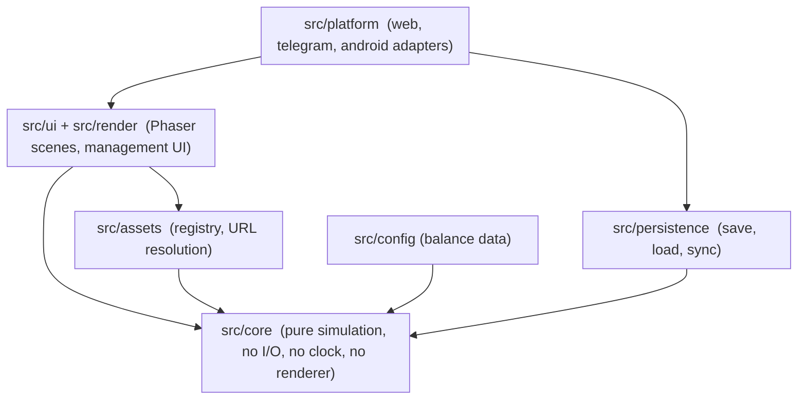

# Technical Architecture

Status: Phase 0 review of the scaffold. Verdicts are based on running the code, not on intent.

## 1. Layers

Dependencies point inward. `src/core` may import nothing from outer layers; ESLint enforces this (rules fail on phaser, render, ui, platform, persistence, assets, Telegram or Capacitor imports). Config values are passed into core as parameters by the composition root (`src/main.ts`), so core defines config *types* and never reads files.

## 2. Scaffold review

| Requirement | Verdict | Evidence / action |
|---|---|---|
| TypeScript strict | Met | `strict`, `noUncheckedIndexedAccess`, `exactOptionalPropertyTypes`, `verbatimModuleSyntax` on; typecheck clean |
| Phaser 3 + Vite | Met | Builds; asset gallery runs in headless Chromium; phaser split into its own 1.48 MB (340 KB gzip) chunk |
| Core isolation | Met, after a fix | Probe file importing phaser, render and assets from core failed lint; the **assets** import was initially *not* caught and the rule was extended |
| Render / UI separation | Partly | Only BootScene exists. UI technology undecided: Phaser game objects vs a DOM overlay. Proposal: DOM overlay for panels (accessible, crisp text), Phaser for the world. Decide in P1-08 |
| Asset registry | Met | `src/assets/manifest.ts`, logical IDs, tests for orphans, missing files, baked text, audio headers, pack manifest equality |
| Persistence boundary | Missing | No interface yet. Add `SaveStore` and versioned save envelope in Phase 1 (local only) |
| Platform adapters | Missing | No interface yet. Add `PlatformAdapter` (id, storage, lifecycle events, haptics) with a web implementation in Phase 1; Telegram and Android later |
| Testing | Partly | Unit tests for rules and assets. No simulation integration tests (no simulation yet), no browser test in CI |
| Config-driven economy | Not started | Only types and docs. Phase 4 |
| Empty `src/core/simulation`, `src/core/economy`, `server/` | Placeholders | Keep as structure markers |

Not introduced: no state-management library, no UI framework, no ECS library, no Capacitor, Telegram SDK, Supabase or server yet. Reason: each is added in the phase that needs it (`ROADMAP.md`).

## 3. Simulation architecture

- **Fixed timestep** (proposal 1 s of sim time per tick at 1x), deterministic: `advance(state, config, rng, ticks) -> state`. Same state, config, seed and ticks give the same result.
- **Seeded RNG** passed in; core never calls `Math.random()` or reads the clock.
- **Events** emitted by core (container arrived, surveyed, moved, repaired, dispatched, revenue earned) and consumed by renderer and UI. Rendering never mutates simulation state.
- **Time**: core receives timestamps. Wall-clock handling lives in the platform layer.
- **Department model**: each department has capacity, a queue and a `step`. Queue pressure produces the congestion effects in `OPERATIONAL_WORKFLOWS.md` section 5.
- **Yard model** (Phase 1): grid of blocks, rows, slots, stack height; laden/empty zoning; occupancy ratio.

## 4. Idle and offline progression

Principle: one pure function, two callers. `advance()` runs live on the client for the visible depot, and offline as `advance(state, config, rng, elapsedTicks)` with elapsed time **clamped to a configurable cap** and supplied by a trusted time source.

- Phase 1 to 4 (local only): client computes offline progress using the device clock, capped, and is explicitly **untrusted**: no real-money or competitive value attaches to it (D12).
- Phase 7 (server authoritative): the server stores `lastSyncServerTime`, recomputes offline progress with the same `advance`, and credits the result. The client clock is never used for rewards. Requests carry a client-generated idempotency key to prevent double claims.
- No complex offline rewards are built before that server architecture exists.

## 5. Persistence

- Save envelope: `{ version, savedAt, payload }`. Every schema change adds a migration `vN -> vN+1` with a test using a frozen sample of the old version.
- Local: `SaveStore` interface (web storage first; Capacitor storage later).
- Cloud (Phase 7): PostgreSQL/Supabase tables per `CONTAINER_DATA_MODEL.md` section 6, with SQL migrations and check constraints mirroring the rule tables. Row-level security on user id.
- Authoritative state and validation live server-side; the client holds a cache.

## 6. Platforms

One codebase and one Vite build with a relative base. `PlatformAdapter` isolates: persistence backend, lifecycle (pause/resume), safe-area and viewport, haptics, share and notifications, auth. Telegram: Mini Apps SDK; **initData is validated server-side** (HMAC with the bot token), never in the client. Android: Capacitor shell, portrait-first, debug APK first, AAB later. Input abstraction maps touch, mouse and keyboard to the same camera/selection commands.

## 7. Testing architecture

- Unit: rules, economy maths (Phase 4), registry (exists).
- Integration: headless workflow simulations over `advance()` (Phase 2).
- Determinism: golden-seed test per milestone.
- Browser: `scripts/browser-check.py` today (manual); Playwright in CI is proposed once Phase 1 has a stable scene, accepted only if it adds more signal than its dependency cost.
- Performance: frame-time and memory budget on a mid-range Android profile before Phase 2 content.

## 7b. Known technical risks

| Risk | Impact | Mitigation |
|---|---|---|
| SVG rasterisation cost on mid-range phones at many instances | Frame drops, memory | Rasterise once per texture (Phaser does), convert to atlases for production, cap draw calls, measure in P1 |
| Isometric depth sorting with stacked containers and moving vehicles | Visual glitches | Sort key from grid coordinates + height, tested in P1-03 |
| Art quality gap to the reference | Producer rejects the look again | Defects and gaps listed honestly in `ASSET_SPECIFICATION.md`; Phase 1 gates on clean sprites |
| Rule ambiguity (D1-D7) | Rework of model and tests | Rules are data tables; decisions requested before Phase 2 |
| Audio autoplay restrictions on mobile | No sound until gesture | Unlock on first tap (done in gallery) |
| Offline exploit via device clock | Economy damage | Cap and untrusted until server (D12) |
| Phaser 3 bundle size (340 KB gzip) | Slow first load on Telegram | Acceptable now; measure, lazy-load scenes if needed |
| Public repository | Leak of domain data | D13; keep game values abstract |
| Dev-only audit findings (vitest transitive `tinypool`, 2 critical, 12 moderate; 0 in production deps) | Tooling risk only | Upgrade vitest in its own PR after review |
