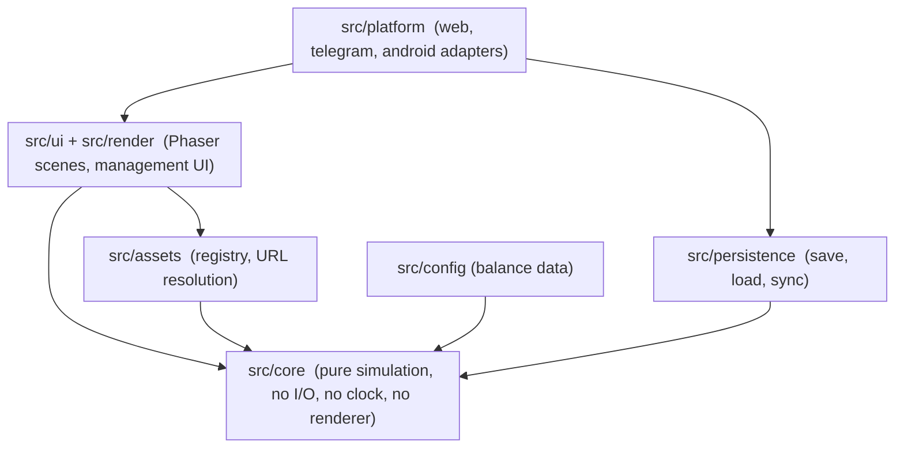

# Technical Architecture

Status: Phase 0 review of the scaffold, updated for the Phase 1 foundation (simulation kernel, persistence, platform boundary; branch `feature/phase-1-sim-kernel-and-boundaries`). Verdicts are based on running the code, not on intent.

## 1. Layers

Dependencies point inward. `src/core` may import nothing from outer layers; ESLint enforces this (rules fail on phaser, render, ui, platform, persistence, assets, Telegram or Capacitor imports). Config values are passed into core as parameters by the composition root (`src/main.ts`), so core defines config *types* and never reads files.

## 2. Scaffold review

| Requirement | Verdict | Evidence / action |
|---|---|---|
| TypeScript strict | Met | `strict`, `noUncheckedIndexedAccess`, `exactOptionalPropertyTypes`, `verbatimModuleSyntax` on; typecheck clean |
| Phaser 3 + Vite | Met | Builds; asset gallery runs in headless Chromium; phaser split into its own 1.48 MB (340 KB gzip) chunk |
| Core isolation | Met, after a fix | Probe file importing phaser, render and assets from core failed lint; the **assets** import was initially *not* caught and the rule was extended |
| Render / UI separation | Partly | Only BootScene exists. UI technology undecided: Phaser game objects vs a DOM overlay. Proposal: DOM overlay for panels (accessible, crisp text), Phaser for the world. Decide in P1-08 |
| Asset registry | Met | `src/assets/manifest.ts`, logical IDs, tests for orphans, missing files, baked text, audio headers, pack manifest equality |
| Persistence boundary | Met (local) | `SaveStore`, versioned envelope with checksum, migration chain, frozen v1 fixture test. Cloud store is Phase 7 |
| Platform adapters | Met (web only) | `PlatformAdapter` (time, seed, storage, lifecycle) with a web implementation; `telegram` and `android` ids are reserved, adapters deliberately unwritten |
| Testing | Partly | 117 unit and integration tests: rules, assets, kernel determinism, persistence, runtime, boot policy. Browser check is manual (`scripts/browser-check.py`), not in CI |
| Config-driven economy | Not started | Only types and docs. Phase 4 |
| Empty `src/core/simulation`, `src/core/economy`, `server/` | Placeholders | Keep as structure markers |

Not introduced: no state-management library, no UI framework, no ECS library, no Capacitor, Telegram SDK, Supabase or server yet. Reason: each is added in the phase that needs it (`ROADMAP.md`).

## 3. Simulation architecture (implemented in `src/core/simulation`)

- **Fixed timestep**: `advance(state, config, modules, ticks) -> { state, events }`. The same state, modules and tick count always give the same result; advancing by a then b equals advancing by a+b (tested). The input is never mutated (work happens on a deep copy). `tickMs` is a provisional placeholder (1000) until Producer decision D10.
- **Per tick**: counter increments, due scheduled commands are delivered in `(at, order)` order to registered handlers, then systems run in array order. Work scheduled during a tick lands on a later tick (delay >= 1), so a tick always terminates. An unknown event type throws; nothing is silently dropped.
- **Seeded RNG** (`Rng`, mulberry32, one uint32 of state saved inside the simulation state, so loading a save continues the same random sequence). Verified against an independent reference implementation. ESLint forbids `Math.random`, `Date`, `performance` and `crypto` inside `src/core`.
- **Events**: two kinds. `emit` records something that happened (output for renderer and UI, never re-delivered); `schedule` queues a command for a future tick. Output events carry a strictly increasing `seq`. Rendering never mutates simulation state.
- **Real time to ticks**: `FixedStepper` (accumulator with a catch-up cap). Integer-millisecond input yields the same ticks however it is sliced into frames; fractional deltas can differ by one tick at a boundary but no time is lost.
- **Modules, not rules**: the kernel is generic over the world. Departments, yard and economy plug in as `systems` and `handlers` later. `DEPOT_MODULES` is intentionally empty until Producer decisions D1-D15 land.
- **Time**: core receives timestamps and ticks. Wall-clock handling lives in the platform layer and `SimRuntime`.
- **Department model**: each department has capacity, a queue and a `step`. Queue pressure produces the congestion effects in `OPERATIONAL_WORKFLOWS.md` section 5.
- **Yard model** (Phase 1): grid of blocks, rows, slots, stack height; laden/empty zoning; occupancy ratio.

## 4. Idle and offline progression

Principle: one pure function, two callers. `advance()` runs live on the client for the visible depot, and offline as `advance(state, config, rng, elapsedTicks)` with elapsed time **clamped to a configurable cap** and supplied by a trusted time source.

- Phase 1 to 4 (local only): client computes offline progress using the device clock, capped, and is explicitly **untrusted**: no real-money or competitive value attaches to it (D12).
- Phase 7 (server authoritative): the server stores `lastSyncServerTime`, recomputes offline progress with the same `advance`, and credits the result. The client clock is never used for rewards. Requests carry a client-generated idempotency key to prevent double claims.
- No complex offline rewards are built before that server architecture exists.

## 4b. Composition root and runtime (implemented)

`src/app/compose.ts` is the only place that wires platform, persistence, config and simulation. `SimRuntime` (`src/app/runtime.ts`) turns frame deltas into ticks, advances the simulation, notifies event subscribers, autosaves every N ticks, and saves on pause. Saves are serialised, so an older snapshot can never overwrite a newer one. Boot policy: empty slot starts a new game from a platform seed; a loadable save resumes; a save that exists but cannot be loaded (corrupt, newer build, failed migration) starts an in-memory game with **saving locked**, so the unreadable save is never overwritten. Lint also forbids `src/core` from importing `src/config` and `src/app`.

## 5. Persistence

- Save envelope (implemented): `{ format, version, savedAt, checksum, payload }`, canonical JSON. The checksum catches accidental corruption (it is not tamper protection). Every schema change bumps `CURRENT_SAVE_VERSION` and adds a migration `vN -> vN+1`; the chain is tested with synthetic migrations, and `tests/fixtures/save-v1.json` is a frozen v1 sample that must load forever. Checksums are verified before migrating. Saves from a newer build are refused. Non-JSON-safe state (NaN, undefined, Map, class instances) is rejected at write time.
- Local (implemented): `SaveStore` interface; `StorageSaveStore` over Web Storage with prefixed keys. If storage is unavailable (private mode) the web adapter falls back to memory and reports `storagePersistent: false`. Not built yet: backup slot, Capacitor storage.
- Cloud (Phase 7): PostgreSQL/Supabase tables per `CONTAINER_DATA_MODEL.md` section 6, with SQL migrations and check constraints mirroring the rule tables. Row-level security on user id.
- Authoritative state and validation live server-side; the client holds a cache.

## 6. Platforms

One codebase and one Vite build with a relative base. `PlatformAdapter` isolates: persistence backend, lifecycle (pause/resume), safe-area and viewport, haptics, share and notifications, auth. Telegram: Mini Apps SDK; **initData is validated server-side** (HMAC with the bot token), never in the client. Android: Capacitor shell, portrait-first, debug APK first, AAB later. Input abstraction maps touch, mouse and keyboard to the same camera/selection commands.

## 7. Testing architecture

- Unit: rules, economy maths (Phase 4), registry (exists).
- Integration: runtime and boot-policy tests exist; headless workflow simulations over `advance()` come with Phase 2.
- Determinism: golden seed test exists (seed 42, 300 ticks, cross-checked against an independent Python re-implementation); add one per milestone.
- Browser: `scripts/browser-check.py` today (manual); Playwright in CI is proposed once Phase 1 has a stable scene, accepted only if it adds more signal than its dependency cost.
- Performance: frame-time and memory budget on a mid-range Android profile before Phase 2 content.

## 7b. Known technical risks

| Risk | Impact | Mitigation |
|---|---|---|
| SVG rasterisation cost on mid-range phones at many instances | Frame drops, memory | Rasterise once per texture (Phaser does), convert to atlases for production, cap draw calls, measure in P1 |
| Isometric depth sorting with stacked containers and moving vehicles | Visual glitches | Sort key from grid coordinates + height, tested in P1-03 |
| Art quality gap to the reference | Producer rejects the look again | Defects and gaps listed honestly in `ASSET_SPECIFICATION.md`; Phase 1 gates on clean sprites |
| Rule ambiguity (D1-D7) | Rework of model and tests | Rules are data tables; decisions requested before Phase 2 |
| Audio autoplay restrictions on mobile | No sound until gesture | Unlock on first tap (done in gallery) |
| Offline exploit via device clock | Economy damage | Cap and untrusted until server (D12) |
| Phaser 3 bundle size (340 KB gzip) | Slow first load on Telegram | Acceptable now; measure, lazy-load scenes if needed |
| Public repository | Leak of domain data | D13; keep game values abstract |
| Dev-only audit findings (vitest transitive `tinypool`, 2 critical, 12 moderate; 0 in production deps) | Tooling risk only | Upgrade vitest in its own PR after review |
